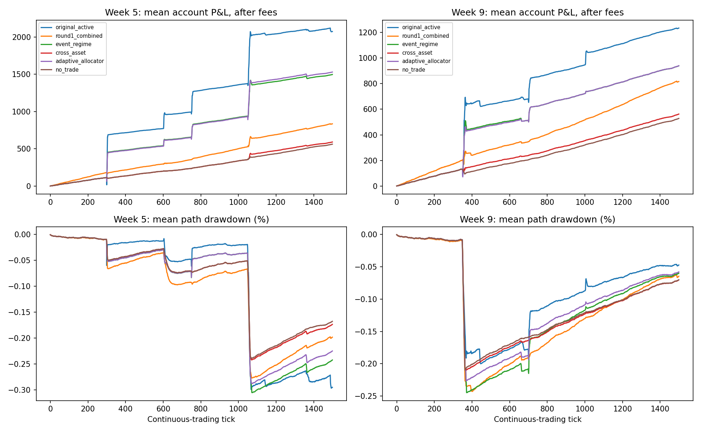
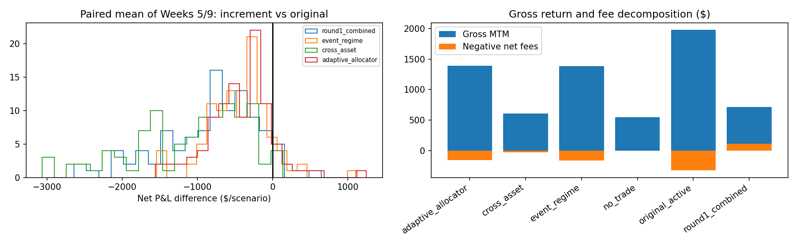

# AlgoArena Alpha Discovery Round II — completion report

No new strategy demonstrates a robust improvement over the active original bot. This is a retrospective research result, not a deployment recommendation or a guarantee of live returns. The original project and Round I audit are preserved.

## What completed and what was preserved

The resumed task inspected saved code, logs, 120 market-data collections (40 discovery seeds × two weeks, 20 validation seeds × two weeks), three historical feature datasets, two 400-run validation files, model grids and frozen-model hashes. Neither completed validation nor Round I experiments were rerun. Both validation files use the **same 20 seeds**; they are not 40 independent seeds. The separate stock-only refit exists but was not substituted for the frozen validated model.

This completion saved **1895 additional exchange/replay runs**. Primary test seeds are **6000–6099**, separate from discovery 4000–4039, validation 4100–4119 and Round I seeds. Strategies, safety thresholds and model hashes were frozen before test execution. No test tuning occurred. Stress scope was reduced before results inspection to conserve usage. All testing used local isolated accounts; no hosted orders were submitted.

| file | saved_runs | expected_runs | status |
| --- | --- | --- | --- |
| validation_development.jsonl | 400 | 400 | completed |
| validation.jsonl | 400 | 400 | completed |
| test.jsonl | 1400 | 1400 | completed |
| priority_stress.jsonl | 480 | 480 | completed |
| historical_frozen.jsonl | 5 | 15 | partial |
| historical_remaining.jsonl | 10 | 10 | completed |

The first historical batch stopped after five saved results because the V3 fixture asserted on an in-flight order arriving after session close. Its partial output and failure log are preserved. Only the ten missing combinations were resumed; the real exchange now rejects closed-session arrivals normally. The two historical files together constitute the planned 15 runs, not 20.

The machine-readable [status manifest](round2/results/experiment_status.json) includes hashes, partial-output counts and deferred work. Raw `.jsonl` journals and `.npz` datasets remain on disk (ignored by Git to avoid enormous diffs).

## Out-of-sample strategy ranking

Dollar figures are means per **1500-tick scenario**, with $175,000 total starting cash plus endowed shares. Pooled estimates average Weeks 5 and 9 **within each seed**, then bootstrap independent seed clusters (10,000 resamples; 95% intervals). Weeks are not counted as independent extra seeds. Confidence intervals are descriptive, unadjusted for multiple strategies and conditional on this generator.

| strategy | seeds | net_pnl | delta_original_active | low_original_active | high_original_active | delta_no_trade | fees | turnover | worst_drawdown_pct | liquidations | position_violations | team_violations |
| --- | --- | --- | --- | --- | --- | --- | --- | --- | --- | --- | --- | --- |
| original_active | 100 | 1,653.74 | 0.00 | 0.00 | 0.00 | 1,108.74 | 326.49 | 0.57 | 1.28 | 0 | 0 | 0 |
| original | 100 | 1,300.97 | -352.77 | -409.57 | -296.56 | 755.97 | 192.66 | 0.33 | 1.28 | 0 | 0 | 0 |
| adaptive_allocator | 100 | 1,234.66 | -419.08 | -501.86 | -333.16 | 689.65 | 156.28 | 0.27 | 0.83 | 0 | 0 | 0 |
| event_regime | 100 | 1,217.86 | -435.88 | -515.27 | -354.31 | 672.85 | 164.55 | 0.29 | 0.83 | 0 | 0 | 0 |
| round1_combined | 100 | 825.63 | -828.11 | -954.42 | -706.01 | 280.63 | -112.30 | 1.10 | 0.87 | 0 | 0 | 0 |
| cross_asset | 100 | 576.53 | -1,077.21 | -1,226.30 | -934.46 | 31.53 | 29.42 | 0.05 | 0.68 | 0 | 0 | 0 |
| no_trade | 100 | 545.01 | -1,108.74 | -1,262.64 | -961.31 | 0.00 | 0.00 | 0.00 | 0.68 | 0 | 0 | 0 |

`original` preserves the exact frozen policy, including its Week 5 gate. `original_active` is the stricter comparator: the same original decision policy with the simulated venue clock supplied and the week gate enabled in both scenarios. This avoids claiming alpha merely by beating an inactive Week 9 bot. Both comparators are retained in the detailed CSV.

| week | strategy | net_pnl | delta_original_active | low_original_active | high_original_active | delta_original | delta_round1_combined |
| --- | --- | --- | --- | --- | --- | --- | --- |
| 5 | adaptive_allocator | 1,529.83 | -543.95 | -672.97 | -414.92 | -543.95 | 695.01 |
| 5 | cross_asset | 590.81 | -1,482.97 | -1,719.20 | -1,254.62 | -1,482.97 | -244.01 |
| 5 | event_regime | 1,496.80 | -576.99 | -708.35 | -445.81 | -576.99 | 661.98 |
| 5 | original | 2,073.78 | 0.00 | 0.00 | 0.00 | 0.00 | 1,238.97 |
| 5 | original_active | 2,073.78 | 0.00 | 0.00 | 0.00 | 0.00 | 1,238.97 |
| 5 | round1_combined | 834.82 | -1,238.97 | -1,445.81 | -1,041.89 | -1,238.97 | 0.00 |
| 9 | adaptive_allocator | 939.49 | -294.21 | -374.82 | -210.24 | 411.33 | 123.04 |
| 9 | cross_asset | 562.26 | -671.44 | -778.56 | -563.86 | 34.10 | -254.19 |
| 9 | event_regime | 938.93 | -294.77 | -369.79 | -217.39 | 410.77 | 122.48 |
| 9 | original | 528.16 | -705.54 | -817.97 | -592.76 | 0.00 | -288.29 |
| 9 | original_active | 1,233.70 | 0.00 | 0.00 | 0.00 | 705.54 | 417.25 |
| 9 | round1_combined | 816.45 | -417.25 | -511.15 | -319.44 | 288.29 | 0.00 |

No-trade is endowed with shares and can earn positive MTM without any trading. Therefore account P&L alone is not alpha. Gross P&L adds back actual net execution fees; it is not a zero-cost counterfactual. Slippage/spread already affect fill prices and are not deducted twice. Detailed fees, rebates, slippage, fills, turnover, session-scaled Sharpe and exposure are in [oos_metrics.csv](round2/results/oos_metrics.csv). The original and new strategies have different target sizes within the same capital/risk envelope; a risk-normalized outperformance claim needs the deferred sizing ablation.

## Transaction-cost and shock stresses

These use the same preselected **20 seed IDs, 6000–6019**, in both weeks: they are robustness checks, not additional independent test seeds. `fees_60bps` doubles taker fees from 30 to 60 bps per side. `volatile` doubles fundamental volatility and background spreads and multiplies configured event magnitude ranges by 1.5. It is a joint stress and cannot isolate which change caused a loss.

| stress | strategy | seeds | net_pnl | delta_original_active | low_original_active | high_original_active | delta_no_trade | fees | worst_drawdown_pct | liquidations | position_violations | team_violations |
| --- | --- | --- | --- | --- | --- | --- | --- | --- | --- | --- | --- | --- |
| fees_60bps | adaptive_allocator | 20 | 918.32 | -497.77 | -697.00 | -318.52 | 418.40 | 244.49 | 0.77 | 0 | 0 | 0 |
| fees_60bps | cross_asset | 20 | 498.04 | -918.06 | -1,252.60 | -611.47 | -1.89 | 26.03 | 0.58 | 0 | 0 | 0 |
| fees_60bps | event_regime | 20 | 908.79 | -507.30 | -716.32 | -318.09 | 408.87 | 269.67 | 0.77 | 0 | 0 | 0 |
| fees_60bps | no_trade | 20 | 499.93 | -916.17 | -1,250.72 | -610.68 | 0.00 | 0.00 | 0.58 | 0 | 0 | 0 |
| fees_60bps | original_active | 20 | 1,416.10 | 0.00 | 0.00 | 0.00 | 916.17 | 555.14 | 1.00 | 0 | 0 | 0 |
| fees_60bps | round1_combined | 20 | 692.97 | -723.13 | -1,013.44 | -461.90 | 193.04 | -59.81 | 0.74 | 0 | 0 | 0 |
| volatile | adaptive_allocator | 20 | 1,287.55 | -478.74 | -1,005.20 | -95.14 | 753.07 | 162.06 | 0.89 | 0 | 0 | 0 |
| volatile | cross_asset | 20 | 552.04 | -1,214.25 | -1,919.62 | -713.48 | 17.57 | 38.23 | 0.90 | 0 | 0 | 0 |
| volatile | event_regime | 20 | 1,280.89 | -485.40 | -1,003.91 | -122.40 | 746.41 | 177.24 | 0.89 | 0 | 0 | 0 |
| volatile | no_trade | 20 | 534.48 | -1,231.81 | -1,953.43 | -711.81 | 0.00 | 0.00 | 0.75 | 0 | 0 | 0 |
| volatile | original_active | 20 | 1,766.29 | 0.00 | 0.00 | 0.00 | 1,231.81 | 228.39 | 1.06 | 0 | 0 | 0 |
| volatile | round1_combined | 20 | 756.72 | -1,009.56 | -1,654.29 | -539.75 | 222.25 | -82.12 | 0.98 | 0 | 0 | 0 |

New policies submit IOC orders and do not depend on maker rebates. Round I combined includes market making and its rebates; report net fees accordingly. The unexecuted 50-seed/four-stress plan is **not** represented as completed. Execution-latency and quote-refresh robustness remain unverified for Round II.

## Historical recordings

| week | strategy | net_pnl | delta_original_active | delta_no_trade | fees | fills | worst_drawdown_pct | liquidations | position_violations |
| --- | --- | --- | --- | --- | --- | --- | --- | --- | --- |
| 2 | adaptive_allocator | 1,055.78 | -1.10 | -1.69 | 1.85 | 4 | 0.27 | 0 | 0 |
| 2 | cross_asset | 1,055.78 | -1.10 | -1.69 | 1.85 | 4 | 0.27 | 0 | 0 |
| 2 | event_regime | 1,057.47 | 0.59 | 0.00 | 0.00 | 0 | 0.27 | 0 | 0 |
| 2 | no_trade | 1,057.47 | 0.59 | 0.00 | 0.00 | 0 | 0.27 | 0 | 0 |
| 2 | original_active | 1,056.88 | 0.00 | -0.59 | 6.84 | 10 | 0.27 | 0 | 0 |
| 3 | adaptive_allocator | 777.98 | -30.97 | 0.00 | 0.00 | 0 | 0.16 | 0 | 0 |
| 3 | cross_asset | 777.98 | -30.97 | 0.00 | 0.00 | 0 | 0.16 | 0 | 0 |
| 3 | event_regime | 777.98 | -30.97 | 0.00 | 0.00 | 0 | 0.16 | 0 | 0 |
| 3 | no_trade | 777.98 | -30.97 | 0.00 | 0.00 | 0 | 0.16 | 0 | 0 |
| 3 | original_active | 808.95 | 0.00 | 30.97 | 13.48 | 18 | 0.16 | 0 | 0 |
| 4 | adaptive_allocator | 380.16 | -19.50 | -20.69 | 5.92 | 15 | 0.23 | 0 | 0 |
| 4 | cross_asset | 349.19 | -50.48 | -51.66 | 19.55 | 29 | 0.24 | 0 | 0 |
| 4 | event_regime | 400.85 | 1.19 | 0.00 | 0.00 | 0 | 0.23 | 0 | 0 |
| 4 | no_trade | 400.85 | 1.19 | 0.00 | 0.00 | 0 | 0.23 | 0 | 0 |
| 4 | original_active | 399.66 | 0.00 | -1.19 | 43.93 | 28 | 0.23 | 0 | 0 |

All available Week 2, 3 and 4 files match the saved recording inventory; no Week 5 historical tape exists in that inventory. These tapes were examined in Round I, so they are **retrospective transfer tests, not genuinely untouched historical holdouts**. Frozen synthetic models are replayed without fitting to these outcomes. Chronological historical refits were deferred. Public books are replayed into the actual matching engine, but a historical book recording does not reveal the counterfactual queue reaction to our orders. Refilled recorded depth and missing cancellations/queue state limit realism. Historical market making/combined replay is omitted rather than assuming valid maker fills. Three days are insufficient for credible historical confidence intervals.

The event policy made **zero fills on all three recordings**: its positive historical account P&L is grant exposure, not event alpha. Cross-asset and allocator activity was negative relative to no-trade where they traded. The active original received one normal `SESSION_CLOSED` arrival rejection per tape; this is not a crash or a fill outside session hours. These sparse, low-participation results do not support transfer of synthetic alpha.

## Sources of apparent alpha and implementation findings

1. **Event state:** public calendar payloads expose direction/magnitude and shock-shape information. The event model predicts remaining repricing from the last pre-announcement mid, public target, observed momentum, phase and liquidity. This is causal access to simulator news, but it encodes a programmed price trajectory. The original already uses this information; rediscovering it is not an independent information advantage.
2. **Cross-asset movement:** lagged peer returns and relative movement predict some synthetic continuations, especially around shared macro shocks. The same generator drives peers; this does not establish a market lead-lag relationship. Microprice, imbalance and trade-flow predictors are entangled with the synthetic background order generator. Its quote spread, refresh interval, depth and informed-flow strength all co-vary with `seed % 3`; these are bundled regimes rather than independently identified effects. Synthetic strategies see four stock books (AAPL, NVDA, NFLX, AMD); historical replay can expose ten, changing the peer-return feature distribution.
3. **Reversal:** the overshoot reversal model has only one qualifying validation opportunity/seed and is disabled. There are only two provisionally supported independent predictors. The third implemented strategy is an allocator of those two, averaging correlated forecasts rather than adding them. It is not a manufactured third alpha.
4. **High severity — `round2/features.py:labels`:** the frozen training screen removes opportunities if a future halt occurs between entry and exit. That is future-outcome selection. Signal-screen returns and model-support flags are therefore biased and cannot establish statistical alpha. The execution tests do not drop those paths: orders encounter actual halts and account MTM includes adverse moves. Thus the untouched direct execution comparison still honestly evaluates the frozen policy, including any consequences of poor training.
5. **Corrected implementation preserved separately:** `round2/labels_review.py:labels_with_halts` records rejected arrivals as zero payoff, retains intermediate halts, delays exits to the first tradable quote, and explicitly counts terminal censoring. Four regression tests cover these cases. It has **not** been used to refit the evaluated policy; no improved-profit claim follows from the fix.
6. **Other limitations:** frozen model fitting included ARENA10 samples although the new policies trade stocks only; `models_stockonly.json` is an untested alternative. The uncertainty deduction `RMSE/sqrt(40)` is a heuristic, not a valid prediction interval. Grid/feature searches share validation data; existing conditional-return intervals do not correct selection. Missing two-sided quotes limit label coverage. These are reasons to reject model-confidence claims, even when execution P&L is measured correctly.
7. **Historical adapter repair:** the saved `history_eval.py` imported `I` from the wrong module. This completion fixes that import and the historical fixture's decision-time/arrival-time assertion (by retaining actual exchange session/auction rejection); frozen synthetic trading code and model hashes stay unchanged. Original clock/session gating, execution callbacks and historical phase handling remain explicit in the adapter.

Validation-only label diagnostics below use the **same frozen prediction threshold**, equities only, every third tick. These are overlapping quote-touch opportunities, **not independent trades, execution results or new confidence intervals**. Correcting selection need not reduce the mean; the sign of the bias is empirical. This diagnostic performs no refit and does not change OOS policies. Full rows are in `label_selection_diagnostics.csv`.

| family | old_labels | corrected_labels | old_mean_bps | corrected_mean_bps |
| --- | --- | --- | --- | --- |
| cross_asset | 36 | 91 | 44.74 | 47.86 |
| event_regime | 83 | 261 | 153.63 | 170.19 |
| overshoot_reversal | 1 | 1 | 9.48 | 9.48 |

## Where profit comes from

The new policies buy selected positive expected repricing, use volatility-dependent sizes, and aim to exit after 10/20 ticks or a 1.8% stop. These are discrete-tick rules; halts/gaps can prevent the stop from executing at its threshold. They retain the initial grant during negative news, whereas the original can sell endowed inventory. The allocator can express more simultaneous opportunities, which also changes exposure. Additional P&L versus Round I, if shown above, is attributable to richer public-event information, entry timing and sizing together—not an isolated proof of a new predictor. Dollar performance versus no-trade separates grant drift, while the original comparison tests whether that package actually improves the incumbent.

Exact terminal-account decomposition versus matched no-trade (means across both scenarios):

| strategy | cash_difference | terminal_overlay_value | endowment_mark_difference | initial_equity_adjustment | net_excess_no_trade | max_accounting_residual |
| --- | --- | --- | --- | --- | --- | --- |
| adaptive_allocator | 641.30 | 48.36 | -0.01 | 0.00 | 689.65 | 0.00 |
| cross_asset | 31.53 | 0.00 | -0.00 | 0.00 | 31.53 | 0.00 |
| event_regime | 624.56 | 48.36 | -0.06 | 0.00 | 672.85 | 0.00 |
| no_trade | 0.00 | 0.00 | 0.00 | 0.00 | 0.00 | 0.00 |
| original | 533.76 | 221.45 | 0.75 | 0.00 | 755.97 | 0.00 |
| original_active | 887.25 | 220.90 | 0.58 | 0.00 | 1,108.74 | 0.00 |
| round1_combined | 278.73 | 0.32 | 1.57 | 0.00 | 280.63 | 0.00 |

Cash differences include executed costs and other cash flows. Terminal overlay value is the extra inventory marked at each candidate's own terminal venue mark. Endowment mark difference captures changes in valuation of granted shares caused by candidate-dependent market paths. These components sum to paired net P&L after the initial-equity adjustment; they do not imply guaranteed liquidation proceeds.

## Execution and risk boundaries

Orders are scheduled at decision time, reserve exposure, and reach the real local matching handler at least one tick later. Wire quantities are frozen in transit. Actual fills, partial fills, commissions/rebates and rejections determine accounts. Halts block decisions; an in-flight order may be rejected on arrival. The observed violation counts above are empirical outcomes, not a mathematical guarantee against every exchange race.

Saved verification counters (including every completed stress and historical row):

```json
{
  "test": {
    "runs": 1400,
    "same_tick_fills": 0,
    "missing_fill_provenance": 0,
    "liquidations": 0,
    "position_violations": 0,
    "team_position_violations": 0,
    "rejection_codes": {
      "SYMBOL_HALTED": 255,
      "ORDER_NOT_FOUND": 62046,
      "POST_ONLY_CROSS": 514,
      "STP_CANCEL": 4
    }
  },
  "priority_stress": {
    "runs": 480,
    "same_tick_fills": 0,
    "missing_fill_provenance": 0,
    "liquidations": 0,
    "position_violations": 0,
    "team_position_violations": 0,
    "rejection_codes": {
      "SYMBOL_HALTED": 118,
      "ORDER_NOT_FOUND": 23106,
      "POST_ONLY_CROSS": 229
    }
  },
  "historical": {
    "runs": 15,
    "same_tick_fills": 0,
    "missing_fill_provenance": 0,
    "liquidations": 0,
    "position_violations": 0,
    "team_position_violations": 0,
    "rejection_codes": {
      "SESSION_CLOSED": 3
    }
  },
  "test_rejections_by_strategy": {
    "adaptive_allocator": {
      "SYMBOL_HALTED": 31
    },
    "cross_asset": {
      "SYMBOL_HALTED": 20
    },
    "event_regime": {
      "SYMBOL_HALTED": 8
    },
    "no_trade": {},
    "original": {
      "SYMBOL_HALTED": 71
    },
    "original_active": {
      "SYMBOL_HALTED": 82
    },
    "round1_combined": {
      "SYMBOL_HALTED": 43,
      "ORDER_NOT_FOUND": 62046,
      "POST_ONLY_CROSS": 514,
      "STP_CANCEL": 4
    }
  },
  "new_strategy_maker_rebates": 0.0,
  "test_unique_keys": 1400
}
```

The large `ORDER_NOT_FOUND` count belongs to Round I combined's cancel/replace behavior, not the new IOC policies. It is a measured operational weakness even though it did not breach position limits here. The new policies' only test rejection code was `SYMBOL_HALTED`, consistent with an order crossing a halt boundary while in transport.

Each experiment shares one $175,000 total budget; Round I combined splits it across two sleeves. The conservative gateway caps at 150 stock shares per single sleeve, reserves pending buys/sells, forbids stock shorts, limits entry gross to min(40% starting cash, $70,000), reserves 60% starting cash, and stops adding risk below 70% starting-cash equity. Independent sleeve budgets are conservative relative to the venue team limit; the study also samples aggregate positions plus pending orders. Price changes can move gross exposure above an entry limit without a new order. There is no live multi-process reconnection/ACK-race certification in this research.

New requests are at most 60 shares; model notional targets are capped at 20% starting cash, and the gateway can reduce them further. Forced final-window unwind attempts are shared across active strategies; a halted position can remain open and is valued using venue MTM. No depth-swept guaranteed cash exit is assumed. Session Sharpe is not annualized and is not an iid significance statistic.

## Actionable improvements, in priority order

1. **Keep the incumbent until a paired improvement is demonstrated.** Use `original_active` as the research comparator; do not replace the live bot with a model merely because gross or no-trade-relative P&L is positive.
2. **Repair training selection before more optimization.** Use `labels_review.py`, keep reject/delay/censor flags, quantify missing-book coverage, and fit stocks only. A new discovery/validation cycle and new sealed seeds are required; 6000–6099 are now spent evaluation data.
3. **Model execution value rather than unconditional touch returns.** Estimate fill probability, fee-adjusted realized markouts and halt-delayed exits from order journals. Replace the heuristic uncertainty haircut with seed/day-block validation and conservative prediction errors.
4. **Isolate event information from exposure.** Compare equal-size original versus event model, remove public shock-shape fields, remove peer features, and separately test grant de-risking on negative news. These are hypotheses, not verified profit improvements; the deferred ablations are necessary.
5. **Demand independent market evidence.** Acquire future untouched recordings and evaluate chronology, realistic latency, depth depletion and no-rebate performance. Do not optimize against a single programmed shock ramp and call it robust alpha.

## Artifacts and reproduction

Charts use saved OOS equity paths without rerunning experiments:





All new strategies are in `round2/strategies.py`; discovery/model code, frozen parameters, source hashes, raw journals and prior partial/development results remain in `round2/`. The original `.env`, live bot, previous audit and unrelated Git changes are preserved. Tests executed in this completion: **11 passed, 0 failed, 0 skipped**; `round2/results/completion_tests.xml`. Seven tests cover existing policy behavior, four cover corrected labels. This does not rerun or recertify the full project suite.

```bash
# Regenerate tables, manifest and report from saved runs (no experiments):
.venv310/bin/python -m round2.completion_report
# Targeted regressions:
.venv310/bin/python -m pytest round2/tests/test_round2.py round2/tests/test_labels_review.py -q
# Exact primary experiment invocation used (writes test.jsonl; use a separate copy to reproduce):
.venv310/bin/python -m round2.experiments --stage test --workers 8
# These completion commands refuse to overwrite an existing output:
.venv310/bin/python -m round2.finish_experiments --stage stress --workers 4
.venv310/bin/python -m round2.finish_experiments --stage history --workers 3
# Resume only unsaved historical combinations from the preserved partial batch:
.venv310/bin/python -m round2.finish_experiments --stage history_resume --workers 2
```

The frozen runner does not make its original full-stage CLI append-safe. Preserve outputs or use a separate repository copy before reproducing that command. The completion runner explicitly refuses overwrites. Existing parameter sensitivity (`model_sensitivity.csv`) and predictor screens (`signal_screens.csv`) are saved development evidence with the label-selection caveat above; they are not new held-out results. Additional large experiments were deliberately deferred under the user's usage constraint.
