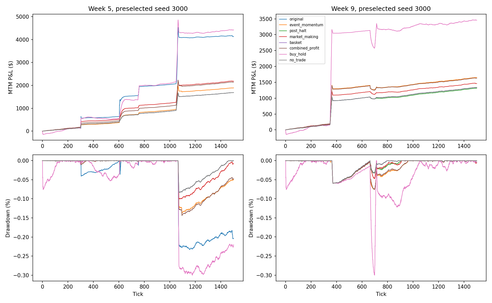
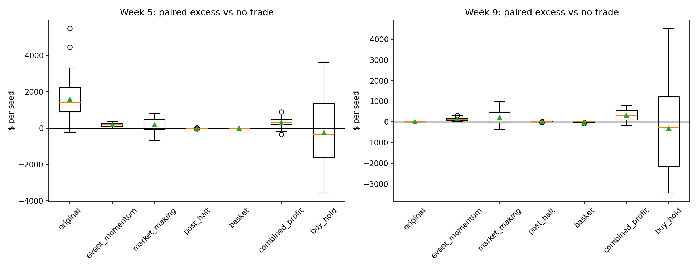
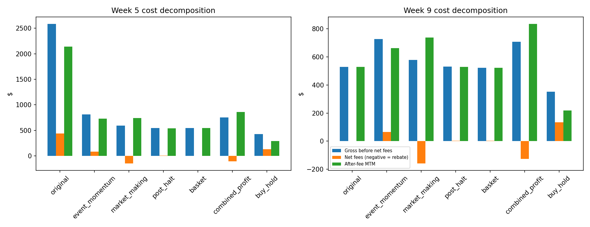
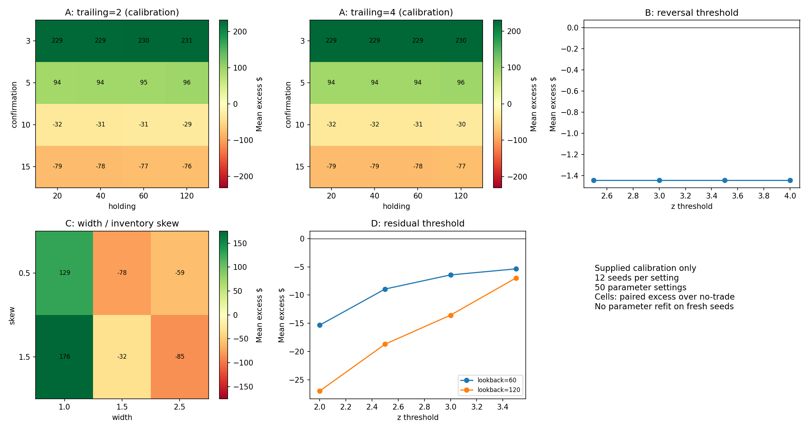
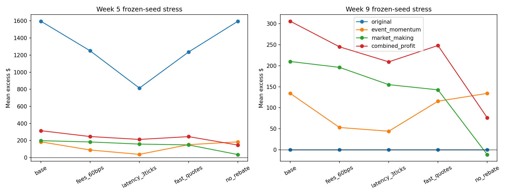

# Independent AlgoArena quantitative audit

## Executive verdict

By mean incremental net P&L across eligible weeks, the best new single strategy is **market_making** and the weakest is **basket**. Among the two active single-strategy finalists, **event_momentum** has the strongest minimum lower confidence bound across tested base/cost/execution regimes (24.24 dollars). This conservative descriptive ranking is conditional on the generator and is not an adjusted multi-test confidence statement. The A+C portfolio is the strongest new combined candidate by base mean P&L; the original dominates absolute Week 5 simulated returns, with different sizing and information.

The primary ranking below is the newly executed, frozen-parameter evaluation on seeds 3000–3049, using the corrected research gateway. Positive synthetic performance is evidence about this specified generator, not convincing real-market alpha. Historical event momentum is negative relative to no-trade on all three available recordings. Do not promote these alphas to the proven live bot on this evidence.

The original Week 5 strategy must be judged separately: it trades larger risk and uses public calendar shock-shape information. In Week 9 it is explicitly disabled. The best new strategy and combined portfolio are identified by after-fee excess below; no-trade is the proper endowed-inventory comparator.

## Executed evidence and reproducibility

```json
{
  "reproduced_runs": 900,
  "matched_primary_runs": 800,
  "max_absolute_pnl_difference": 0.0,
  "fill_count_mismatches": 0,
  "historical_runs": 15,
  "historical_max_pnl_difference": 0.0,
  "paired_correction_runs": 500
}
```

Archive SHA256: `1fe1d222c67447ace8f14ba5bcc2a9a8e1ce91e3b0303a5d344ba84f23f7cf76`. Extracted code is preserved unchanged under `extracted/2026Autumn-6-fresh`. All new code, output and fixes live under `audit_review/`; `.env` and live bot code were not edited by this audit.

Archive tests: **317 passed, 3 skipped**, 320 collected, 0 failures/errors (see XML). The root repository suite also passed **317 tests with 3 skips**, with extracted copies excluded from default discovery. Audit regressions: **14 passed**. The first sandboxed root run had two localhost-binding permission failures; the permitted rerun passed with the non-loopback guard still active. Network guard blocks non-loopback socket connections; only isolated local mechanics are used. The tests that require live smoke execution remain skipped. Diagnostic regressions intentionally reproduce two unsafe original-exchange outcomes; a passing diagnostic is evidence that the bug exists, not that the original venue was repaired. The corrected fixture is tested separately against the ACK settlement interleaving.

Executed synthetic trials in this audit: reproduction 900, fresh corrected 900, corrected stress 2000, paired correction diagnostics 500. Each complete comparison uses 50 identical exogenous seeds per strategy/week; price paths can respond to the candidate’s actual order impact, so realized prices are not artificially forced identical; weeks are different scenarios using the same seed IDs, not 100 independent seeds. Seeds 1000–1049 are reproduction only; new seeds 3000–3049 were fixed before inspecting outcomes. No parameter retuning on them.

The ZIP omits all three historical recordings. Local external copies match the archived SHA256 inventory exactly; 15 funded historical replays are reproduced separately. This is not a self-contained archive and these previously inspected days are not pristine held-out data. There is no Week 5 historical tape. Synthetic experiments never silently stand in for historical backtests.

Supplied files document 624 calibration, 800 primary OOS, 550 ablation, 2400 stress, 500 secondary confirmation and 900 secondary stress runs: 5774 seeded trials, 112 distinct seed IDs (12 calibration + 50 primary + 50 confirmation). Fee-audit replays, illustrative curves and historical replays are not additional independent seeds. Saved outputs show execution, but only the explicitly reproduced subsets are independently verified here.

## Fresh out-of-sample ranking

| week | strategy | seeds | net_pnl | excess_no_trade | excess_ci_low | excess_ci_high | gross_pnl | mean_net_transaction_costs | mean_fills |
| --- | --- | --- | --- | --- | --- | --- | --- | --- | --- |
| 5 | original | 50 | 2,140.85 | 1,596.51 | 1,307.61 | 1,904.39 | 2,583.76 | 442.91 | 29.74 |
| 5 | combined_profit | 50 | 859.19 | 314.84 | 248.98 | 380.34 | 756.10 | -103.09 | 329.66 |
| 5 | market_making | 50 | 742.46 | 198.12 | 101.07 | 292.81 | 594.74 | -147.72 | 304.28 |
| 5 | event_momentum | 50 | 728.67 | 184.33 | 155.91 | 213.03 | 810.85 | 82.17 | 10.86 |
| 5 | combined | 50 | 688.72 | 144.38 | 116.84 | 173.34 | 759.24 | 70.52 | 12.14 |
| 5 | basket | 50 | 544.34 | 0.00 | 0.00 | 0.00 | 544.34 | 0.00 | 0 |
| 5 | no_trade | 50 | 544.34 | 0.00 | 0.00 | 0.00 | 544.34 | 0.00 | 0 |
| 5 | post_halt | 50 | 540.04 | -4.30 | -7.57 | -1.48 | 546.88 | 6.84 | 1.30 |
| 5 | buy_hold | 50 | 292.68 | -251.67 | -735.49 | 275.23 | 426.58 | 133.90 | 10.42 |
| 9 | combined_profit | 50 | 835.33 | 306.05 | 228.51 | 381.63 | 707.86 | -127.46 | 381.62 |
| 9 | market_making | 50 | 739.40 | 210.12 | 115.64 | 303.27 | 579.69 | -159.71 | 353.82 |
| 9 | event_momentum | 50 | 663.49 | 134.21 | 112.33 | 154.99 | 728.20 | 64.71 | 11.08 |
| 9 | combined | 50 | 638.25 | 108.97 | 86.02 | 131.66 | 694.18 | 55.93 | 12.04 |
| 9 | no_trade | 50 | 529.28 | 0.00 | 0.00 | 0.00 | 529.28 | 0.00 | 0 |
| 9 | original | 50 | 529.28 | 0.00 | 0.00 | 0.00 | 529.28 | 0.00 | 0 |
| 9 | post_halt | 50 | 528.75 | -0.53 | -2.32 | 1.11 | 532.16 | 3.41 | 0.92 |
| 9 | basket | 50 | 521.59 | -7.69 | -11.57 | -4.64 | 523.62 | 2.03 | 1.74 |
| 9 | buy_hold | 50 | 217.76 | -311.52 | -838.77 | 221.60 | 351.66 | 133.90 | 10.48 |

All dollars are mean per 1500-tick trial, not projected live-session dollars. Starting cash is a controlled $175,000 TOTAL per experiment, taken from configured trader 1, plus the exchange grant; the live configuration is $175,000/$175,000/$350,000 for trader 1/trader 2/broker. Thus this is not a $700,000 three-seat live-account replay, and the combined experiment splits a common $175,000 budget rather than duplicating live account allocations; all fees come from actual portfolio accounting. The study deliberately charges taker 30 bps (the earlier requested research setting), with maker rebate 10 bps where eligible. The repository’s bare default taker setting is 15 bps and can be overridden by venue/environment configuration; no claim is made that 30 bps is the universal hosted default. Week 9 cancellation fees included. Gross = net MTM P&L + actual net execution fees; carry is still deducted. This is an accounting decomposition, not a zero-fee counterfactual. Slippage vs decision mid is already inside P&L and is not subtracted twice.

Pairwise differences use the same seeds; do not infer superiority merely from overlapping or non-overlapping marginal intervals.

| week | left | right | seeds | mean_difference | ci_low | ci_high |
| --- | --- | --- | --- | --- | --- | --- |
| 5 | market_making | event_momentum | 50 | 13.79 | -90.21 | 118.08 |
| 5 | combined_profit | event_momentum | 50 | 130.52 | 59.28 | 198.23 |
| 5 | original | event_momentum | 50 | 1,412.18 | 1,121.21 | 1,720.36 |
| 9 | market_making | event_momentum | 50 | 75.91 | -28.33 | 178.14 |
| 9 | combined_profit | event_momentum | 50 | 171.84 | 88.24 | 253.58 |
| 9 | original | event_momentum | 50 | -134.21 | -155.91 | -113.18 |

## Risk and trading statistics

| week | strategy | session_sharpe | worst_drawdown_pct | profit_factor | closed_fill_win_rate_pct | mean_turnover | mean_fills | liquidations | position_violations | team_violations |
| --- | --- | --- | --- | --- | --- | --- | --- | --- | --- | --- |
| 5 | original | 1.47 | 0.95 | 13.14 | 79.10 | 0.77 | 29.74 | 0 | 0 | 0 |
| 5 | combined_profit | 1.96 | 0.74 | 2.88 | 85.98 | 0.98 | 329.66 | 0 | 0 | 0 |
| 5 | market_making | 1.79 | 1.01 | 1.89 | 80.90 | 0.87 | 304.28 | 0 | 0 | 0 |
| 5 | event_momentum | 1.80 | 0.48 | 13.46 | 84.03 | 0.14 | 10.86 | 0 | 0 | 0 |
| 5 | combined | 1.66 | 0.53 | 10.34 | 77.70 | 0.12 | 12.14 | 0 | 0 | 0 |
| 5 | basket | 1.80 | 0.57 | N/A | N/A | 0.00 | 0 | 0 | 0 | 0 |
| 5 | no_trade | 1.80 | 0.57 | N/A | N/A | 0.00 | 0 | 0 | 0 | 0 |
| 5 | post_halt | 1.79 | 0.57 | 0.27 | 28.12 | 0.01 | 1.30 | 0 | 0 | 0 |
| 5 | buy_hold | 0.26 | 2.51 | N/A | N/A | 0.23 | 10.42 | 0 | 0 | 0 |
| 9 | combined_profit | 2.11 | 0.55 | 2.99 | 85.79 | 1.29 | 381.62 | 0 | 0 | 0 |
| 9 | market_making | 2.22 | 0.65 | 1.94 | 80.29 | 1.17 | 353.82 | 0 | 0 | 0 |
| 9 | event_momentum | 1.67 | 0.40 | 331.17 | 95.97 | 0.11 | 11.08 | 0 | 0 | 0 |
| 9 | combined | 1.54 | 0.45 | 52.24 | 90.30 | 0.10 | 12.04 | 0 | 0 | 0 |
| 9 | no_trade | 2.04 | 0.49 | N/A | N/A | 0.00 | 0 | 0 | 0 | 0 |
| 9 | original | 2.04 | 0.49 | N/A | N/A | 0.00 | 0 | 0 | 0 | 0 |
| 9 | post_halt | 2.04 | 0.49 | 0.76 | 29.17 | 0.01 | 0.92 | 0 | 0 | 0 |
| 9 | basket | 2.01 | 0.49 | 0.00 | 0.00 | 0.00 | 1.74 | 0 | 0 | 0 |
| 9 | buy_hold | 0.11 | 2.08 | N/A | N/A | 0.23 | 10.48 | 0 | 0 | 0 |

Sharpe is session-scaled tick-return Sharpe, not annualized or an iid significance test. Profit factor pools positive/negative FIFO closing-fill P&L across independently matched accounts, including entry/exit fill commissions and rebates, and adds period cancellation/carry expenses to the loss denominator. This is an expense-adjusted closed-fill diagnostic, not a round-trip PF; the unallocated closed-fill PF is also exported. Non-fill expenses are not assigned arbitrarily to individual lots. The report uses overlay FIFO initialized at zero change from starting inventory: selling endowed shares opens a virtual short overlay, and buying them back closes it. This does not submit an actual stock short. It avoids assigning an arbitrary initial reference price to granted shares. Raw journals also preserve the earlier endowment-inclusive FIFO diagnostic, which is not used for this report’s profit factor. N/A means no losses or no closed fills, never an infinite profit claim. “Trades” here means fill messages; partial fills count separately. The exchange values the full position at the best bid/ask without a depth sweep, and own quotes can affect those marks. These are venue MTM results, not guaranteed exit cash. Net MTM includes open holdings; profit factor on closed fills cannot explain all MTM gains. Full fields, costs, slippage, closed counts and provenance counters are in `results/strategy_metrics.csv`.

No-trade earns/loses on granted inventory, so a positive net account P&L alone is not alpha. Buy-and-hold invests 30% across four active equities, capped at 150 shares each; it is not a fully invested broad-market benchmark. Combined sleeves share total starting cash and conservative independent caps; it is a coordinated-capital experiment, not an atomic hedge execution service.

## Paired effect of correctness fixes

| week | strategy | seeds | mean_pnl_change | min_pnl_change | max_pnl_change | ci_low | ci_high | mean_fill_change |
| --- | --- | --- | --- | --- | --- | --- | --- | --- |
| 5 | basket | 50 | 0.00 | 0.00 | 0.00 | 0.00 | 0.00 | 0 |
| 5 | event_momentum | 50 | 0.00 | 0.00 | 0.00 | 0.00 | 0.00 | 0 |
| 5 | market_making | 50 | 0.00 | 0.00 | 0.00 | 0.00 | 0.00 | 0 |
| 5 | no_trade | 50 | 0.00 | 0.00 | 0.00 | 0.00 | 0.00 | 0 |
| 5 | post_halt | 50 | 0.00 | 0.00 | 0.00 | 0.00 | 0.00 | 0 |
| 9 | basket | 50 | 0.01 | -0.00 | 0.30 | -0.00 | 0.02 | 0 |
| 9 | event_momentum | 50 | 0.00 | 0.00 | 0.00 | 0.00 | 0.00 | 0 |
| 9 | market_making | 50 | 0.00 | 0.00 | 0.00 | 0.00 | 0.00 | 0 |
| 9 | no_trade | 50 | 0.00 | 0.00 | 0.00 | 0.00 | 0.00 | 0 |
| 9 | post_halt | 50 | 0.00 | 0.00 | 0.00 | 0.00 | 0.00 | 0 |

These differences compare corrected and original gateways on the SAME previously viewed seeds 1000–1049. They measure implementation effects, not new OOS alpha or a newly optimized strategy. A/B/C have exactly unchanged P&L on all 50 paired seeds; only basket changes, by about $0.006 per Week 9 run on average. Therefore the measured A/C gains should not be blamed on the gateway arrival check: their main external-validity concerns are population/fees/exposure. Fixes are retained for defensible order/risk semantics even where mean returns do not improve. The separate buffered-settlement fixture is not mixed into these serialized results.

## Stress results

| week | strategy | regime | seeds | excess_no_trade | excess_ci_low | excess_ci_high | mean_net_transaction_costs | liquidations |
| --- | --- | --- | --- | --- | --- | --- | --- | --- |
| 5 | combined_profit | fast_quotes | 50 | 245.52 | 174.83 | 313.30 | -102.70 | 0 |
| 5 | combined_profit | fees_60bps | 50 | 246.54 | 181.43 | 307.63 | -39.14 | 0 |
| 5 | combined_profit | latency_3ticks | 50 | 212.74 | 142.44 | 284.78 | -143.13 | 0 |
| 5 | combined_profit | no_rebate | 50 | 146.79 | 81.44 | 208.61 | 64.69 | 0 |
| 5 | event_momentum | fast_quotes | 50 | 151.42 | 132.03 | 169.24 | 81.17 | 0 |
| 5 | event_momentum | fees_60bps | 50 | 88.94 | 58.52 | 119.10 | 163.77 | 0 |
| 5 | event_momentum | latency_3ticks | 50 | 37.89 | 24.24 | 52.39 | 29.82 | 0 |
| 5 | event_momentum | no_rebate | 50 | 184.33 | 154.30 | 213.85 | 82.17 | 0 |
| 5 | market_making | fast_quotes | 50 | 148.54 | 66.08 | 227.31 | -151.72 | 0 |
| 5 | market_making | fees_60bps | 50 | 183.30 | 84.33 | 277.72 | -132.91 | 0 |
| 5 | market_making | latency_3ticks | 50 | 158.39 | 44.68 | 269.10 | -154.92 | 0 |
| 5 | market_making | no_rebate | 50 | 35.31 | -60.84 | 126.14 | 14.82 | 0 |
| 5 | no_trade | fast_quotes | 50 | 0.00 | 0.00 | 0.00 | 0.00 | 0 |
| 5 | no_trade | fees_60bps | 50 | 0.00 | 0.00 | 0.00 | 0.00 | 0 |
| 5 | no_trade | latency_3ticks | 50 | 0.00 | 0.00 | 0.00 | 0.00 | 0 |
| 5 | no_trade | no_rebate | 50 | 0.00 | 0.00 | 0.00 | 0.00 | 0 |
| 5 | original | fast_quotes | 50 | 1,236.84 | 1,007.06 | 1,470.89 | 397.13 | 0 |
| 5 | original | fees_60bps | 50 | 1,249.96 | 989.43 | 1,531.20 | 743.92 | 0 |
| 5 | original | latency_3ticks | 50 | 813.84 | 622.71 | 1,022.34 | 258.62 | 0 |
| 5 | original | no_rebate | 50 | 1,596.51 | 1,295.56 | 1,906.18 | 442.91 | 0 |
| 9 | combined_profit | fast_quotes | 50 | 248.25 | 180.14 | 322.04 | -121.97 | 0 |
| 9 | combined_profit | fees_60bps | 50 | 245.08 | 168.40 | 319.40 | -80.51 | 0 |
| 9 | combined_profit | latency_3ticks | 50 | 209.31 | 143.73 | 273.46 | -155.54 | 0 |
| 9 | combined_profit | no_rebate | 50 | 76.17 | 15.66 | 136.41 | 102.08 | 0 |
| 9 | event_momentum | fast_quotes | 50 | 115.55 | 95.55 | 135.62 | 65.24 | 0 |
| 9 | event_momentum | fees_60bps | 50 | 52.97 | 31.44 | 75.79 | 121.50 | 0 |
| 9 | event_momentum | latency_3ticks | 50 | 44.13 | 29.76 | 59.75 | 35.06 | 0 |
| 9 | event_momentum | no_rebate | 50 | 134.21 | 113.34 | 155.25 | 64.71 | 0 |
| 9 | market_making | fast_quotes | 50 | 142.66 | 58.11 | 234.32 | -159.44 | 0 |
| 9 | market_making | fees_60bps | 50 | 196.17 | 100.18 | 292.70 | -145.76 | 0 |
| 9 | market_making | latency_3ticks | 50 | 155.01 | 77.73 | 231.45 | -167.56 | 0 |
| 9 | market_making | no_rebate | 50 | -11.54 | -89.15 | 66.13 | 61.62 | 0 |
| 9 | no_trade | fast_quotes | 50 | 0.00 | 0.00 | 0.00 | 0.00 | 0 |
| 9 | no_trade | fees_60bps | 50 | 0.00 | 0.00 | 0.00 | 0.00 | 0 |
| 9 | no_trade | latency_3ticks | 50 | 0.00 | 0.00 | 0.00 | 0.00 | 0 |
| 9 | no_trade | no_rebate | 50 | 0.00 | 0.00 | 0.00 | 0.00 | 0 |
| 9 | original | fast_quotes | 50 | 0.00 | 0.00 | 0.00 | 0.00 | 0 |
| 9 | original | fees_60bps | 50 | 0.00 | 0.00 | 0.00 | 0.00 | 0 |
| 9 | original | latency_3ticks | 50 | 0.00 | 0.00 | 0.00 | 0.00 | 0 |
| 9 | original | no_rebate | 50 | 0.00 | 0.00 | 0.00 | 0.00 | 0 |

Fees_60bps doubles taker costs while leaving the real maker schedule unchanged. Latency_3ticks freezes requests for three ticks. Fast_quotes refreshes the synthetic provider each tick, exposing dependence on stale counterparty quotes. No_rebate explicitly removes maker rebates and reports this as a counterfactual, not the venue default. All retain actual matching/risk/order quotas. Spread/depth/TTL/informedness remain confounded in the base generator; `regime_conditions.csv` is descriptive, not a causal spread estimate. Fresh stress seeds are the same 50 IDs for paired comparison, not additional independent days.

## Event regime coverage

| week | event_tick | symbol | direction | seeds | strategy | mean_excess |
| --- | --- | --- | --- | --- | --- | --- |
| 5 | 300 | NFLX | up | 26 | event_momentum | 199.71 |
| 5 | 300 | NFLX | up | 26 | market_making | 390.48 |
| 5 | 300 | NFLX | up | 26 | combined_profit | 408.65 |
| 5 | 300 | NFLX | down | 24 | event_momentum | 167.67 |
| 5 | 300 | NFLX | down | 24 | market_making | -10.27 |
| 5 | 300 | NFLX | down | 24 | combined_profit | 213.22 |
| 5 | 750 | AMD | up | 24 | event_momentum | 191.09 |
| 5 | 750 | AMD | up | 24 | market_making | 264.38 |
| 5 | 750 | AMD | up | 24 | combined_profit | 315.57 |
| 5 | 750 | AMD | down | 26 | event_momentum | 178.08 |
| 5 | 750 | AMD | down | 26 | market_making | 136.95 |
| 5 | 750 | AMD | down | 26 | combined_profit | 314.17 |
| 5 | 1050 | * | up | 26 | event_momentum | 220.66 |
| 5 | 1050 | * | up | 26 | market_making | 302.55 |
| 5 | 1050 | * | up | 26 | combined_profit | 399.38 |
| 5 | 1050 | * | down | 24 | event_momentum | 144.97 |
| 5 | 1050 | * | down | 24 | market_making | 84.98 |
| 5 | 1050 | * | down | 24 | combined_profit | 223.26 |
| 9 | 350 | * | up | 26 | event_momentum | 161.03 |
| 9 | 350 | * | up | 26 | market_making | 332.71 |
| 9 | 350 | * | up | 26 | combined_profit | 388.06 |
| 9 | 350 | * | down | 24 | event_momentum | 105.15 |
| 9 | 350 | * | down | 24 | market_making | 77.31 |
| 9 | 350 | * | down | 24 | combined_profit | 217.20 |
| 9 | 700 | NVDA | up | 24 | event_momentum | 162.58 |
| 9 | 700 | NVDA | up | 24 | market_making | 277.32 |
| 9 | 700 | NVDA | up | 24 | combined_profit | 362.20 |
| 9 | 700 | NVDA | down | 26 | event_momentum | 108.02 |
| 9 | 700 | NVDA | down | 26 | market_making | 148.08 |
| 9 | 700 | NVDA | down | 26 | combined_profit | 254.22 |

Direction groups condition total trial P&L on one event sign; they do not isolate that event’s causal contribution because each trial contains other shocks. `event_manifest.csv` reconstructs deterministic resolved events from the isolated calendar RNG, validated against four full actual no-trade replays. Resolved directions are used only for this post-run audit and are never passed into the alpha strategies. There are 250 price events across the 50 fresh seeds and two scenarios.

## Supplied volatility stress (not independently rerun)

| week | strategy | seeds | mean_excess | ci_low | ci_high | net_fees |
| --- | --- | --- | --- | --- | --- | --- |
| 5 | original | 50 | 1,719.58 | 1,376.51 | 2,079.02 | 287.37 |
| 5 | market_making | 50 | 162.78 | 25.09 | 297.98 | -111.53 |
| 5 | event_momentum | 50 | 114.31 | 88.88 | 141.22 | 42.62 |
| 5 | combined | 50 | 90.73 | 66.77 | 117.25 | 36.67 |
| 5 | basket | 50 | 0.00 | 0.00 | 0.00 | 0.00 |
| 5 | no_trade | 50 | 0.00 | 0.00 | 0.00 | 0.00 |
| 5 | post_halt | 50 | -0.49 | -1.29 | 0.28 | 1.72 |
| 5 | buy_hold | 50 | -232.94 | -941.94 | 471.81 | 134.01 |
| 9 | market_making | 50 | 156.59 | 28.27 | 284.47 | -133.12 |
| 9 | event_momentum | 50 | 140.78 | 114.19 | 168.39 | 62.38 |
| 9 | combined | 50 | 116.67 | 90.03 | 143.96 | 54.93 |
| 9 | no_trade | 50 | 0.00 | 0.00 | 0.00 | 0.00 |
| 9 | original | 50 | 0.00 | 0.00 | 0.00 | 0.00 |
| 9 | post_halt | 50 | -0.46 | -3.27 | 3.14 | 3.16 |
| 9 | basket | 50 | -27.98 | -40.50 | -17.42 | 5.41 |
| 9 | buy_hold | 50 | -290.17 | -948.64 | 356.51 | 134.01 |

This archived stress doubles the seed-specific volatility multiplier and magnifies scheduled shocks by 1.5. It is additional supplied evidence, not part of the new frozen 50-seed rerun. Fresh base regimes already span volatility multipliers 0.5, 1, 2 and 4; their conditional outcomes are exported in `volatility_regimes.csv`.

## Historical evidence

| file | strategy | net_pnl | excess_no_trade | commissions | slippage | fills | pnl_reproduction_delta |
| --- | --- | --- | --- | --- | --- | --- | --- |
| session_week02_20261009_204000.jsonl.gz | basket | 1,057.47 | 0.00 | 0 | 0 | 0 | 0.00 |
| session_week02_20261009_204000.jsonl.gz | post_halt | 1,057.47 | 0.00 | 0 | 0 | 0 | 0.00 |
| session_week02_20261009_204000.jsonl.gz | event_momentum | 907.37 | -150.10 | 75.23 | 23.74 | 95 | 0.00 |
| session_week03_20261016_204000_market.jsonl | event_momentum | 734.97 | -43.01 | 12.54 | -0.70 | 21 | 0.00 |
| session_week02_20261009_204000.jsonl.gz | no_trade | 1,057.47 | 0.00 | 0 | 0 | 0 | 0.00 |
| session_week02_20261009_204000.jsonl.gz | buy_hold | 2,034.19 | 976.71 | 116.65 | 22.80 | 317 | 0.00 |
| session_week03_20261016_204000_market.jsonl | post_halt | 777.98 | 0.00 | 0 | 0 | 0 | 0.00 |
| session_week03_20261016_204000_market.jsonl | basket | 777.98 | 0.00 | 0 | 0 | 0 | 0.00 |
| session_week03_20261016_204000_market.jsonl | buy_hold | -673.55 | -1,451.53 | 107.93 | 11.27 | 300 | 0.00 |
| session_week04_20261023_204025_market.jsonl | post_halt | 400.85 | 0.00 | 0 | 0 | 0 | 0.00 |
| session_week04_20261023_204025_market.jsonl | event_momentum | 171.01 | -229.84 | 73.52 | 52.98 | 82 | 0.00 |
| session_week03_20261016_204000_market.jsonl | no_trade | 777.98 | 0.00 | 0 | 0 | 0 | 0.00 |
| session_week04_20261023_204025_market.jsonl | basket | 400.85 | 0.00 | 0 | 0 | 0 | 0.00 |
| session_week04_20261023_204025_market.jsonl | buy_hold | 469.80 | 68.95 | 98.28 | 10.00 | 226 | 0.00 |
| session_week04_20261023_204025_market.jsonl | no_trade | 400.85 | 0.00 | 0 | 0 | 0 | 0.00 |

Replay uses real exchange order handling against reconstructed recorded ladders with funded providers, depth capped at 60 per level and 200 initial stock shares/provider. Historical recordings do not reveal queue identities, future order cancellations, latency or the counterfactual impact of our bot. Therefore market making is deliberately not scored on these tapes. Post-halt and basket inactivity is not successful alpha; futures were unavailable and usable halt/reversal opportunities absent. All three event-momentum days underperform no-trade, even after adding commissions back, so simply reducing fees does not establish historical profitability.

## Supplied strategy ablations (not independently rerun)

| week | variant | seeds | excess_no_trade | net_fees | fills |
| --- | --- | --- | --- | --- | --- |
| 5 | event_momentum:ablation:no_fee_gate | 50 | 211.63 | 79.81 | 10.76 |
| 5 | event_momentum:ablation:no_trailing | 50 | 204.86 | 79.79 | 10.76 |
| 5 | market_making:ablation:no_adverse_filter | 50 | 140.02 | -171.10 | 355.94 |
| 5 | market_making:ablation:no_microprice | 50 | 123.79 | -142.16 | 300.78 |
| 5 | market_making:ablation:no_inventory_skew | 50 | 110.24 | -135.62 | 297.76 |
| 5 | no_trade | 50 | 0.00 | 0.00 | 0.00 |
| 5 | post_halt:ablation:no_earnings_filter | 50 | -2.14 | 3.30 | 0.82 |
| 5 | post_halt:ablation:no_reversal | 50 | -35.94 | 28.19 | 6.14 |
| 9 | no_trade | 50 | 0.00 | 0.00 | 0.00 |
| 9 | basket:ablation:fixed_beta | 50 | -2.81 | 0.86 | 0.80 |
| 9 | basket:ablation:unhedged | 50 | -4.66 | 0.91 | 0.76 |

Removing the fee gate changes Week 5 excess by only about $1, and removing trailing costs about $5 on the supplied seeds. Those small deltas do not validate an optimal exit rule. Removing reversal confirmation worsens B from about -$2 to -$36 while increasing fills: extra activity is not extra alpha. Microprice and inventory-skew deltas are small relative to seed dispersion; no independent significance claim is made. Removing the adverse filter increases rebates/turnover, so its higher raw P&L cannot be read as better information prediction.

## Code audit: severity and exact functions

20 findings: 8 High, 11 Medium, 1 Low. These include demonstrated original-venue defects, measurement limitations and external-validity concerns; they are not all claims of realized P&L distortion.
### High: `engine/exchange/server.py:1146` — `ExchangeServer._handle_place_order / close_session`

Held MOC orders are absent from book.open_quantity risk reservations; close_session injects them directly into the closing book without a new admission check. Verified Week 9 case: three individually valid 500-share MOC buys produce 1500 shares under a 1000-share team cap. Unfixed in original and buffered-settlement fixture; no audited alpha uses MOC and performance runs do not close the session. Must reserve held MOC exposure/cash and revalidate auction eligibility before using this order type.

### High: `engine/exchange/server.py:1226` — `ExchangeServer._handle_place_order`

Matching removes liquidity before awaited ACK delivery, while portfolio settlement follows ACK. Concurrent seats can both validate against old team positions. Actual-handler regression produces 1000 shares from two 500-share buys under the Week 5 800-share team cap. Serialized backtests cannot reveal this race. Separate BufferedSettlementExchange serializes order mutation and buffers outbound delivery until settlement completes; regression rejects the second order. Full production tick/auction/transport coordination remains outside this fixture.

### High: `alpha_lab/risk.py:45` — `Gateway.allowed_quantity`

A reducing flag depends only on initial sign; futures orders can cross flat and bypass the equity, cash and gross entry tests. Regression: short 1, buy 21 with zero cash allowed. CorrectedGateway clips reducing requests to flat; dedicated regression.

### High: `alpha_lab/risk.py:103` — `Gateway.execute_due`

Rechecks server prices/cash/halt after transport delay and silently changes or discards the already-submitted payload. This is arrival-time privileged control, not ordinary exchange rejection. CorrectedGateway freezes non-contingent order payload; actual exchange decides arrival acceptance.

### High: `alpha_lab/risk.py:119` — `Gateway.execute_due`

Cumulative group fills are reused across exit retries; minimum hedge of 1 can overhedge fractional first-leg fills. Failure of second-leg admission can leave an unhedged first leg. Fresh attempt IDs and round-to-zero implemented. Atomicity and bounded unwind remain unresolved.

### High: `alpha_lab/runner.py:105` — `MarketPopulation.refresh / flow`

Synthetic liquidity anchors to the venue reference, with fixed TTL/depth and exogenous buy flow insensitive to actual fees. Our due orders always precede external flow. Matching is real but profitable counterparties are artificial. Fast quote refresh and no rebate stress tested separately; historical queue claims remain unsupported.

### High: `alpha_lab/runner.py:232` — `run_one`

Last 12 ticks replace strategies, including the original, with an imposed unwind, while buy-and-hold is left marked. No actual closing auction. Exit/terminal costs are not identical between baselines. Preserved for reproducibility; disclose results as MTM under this terminal convention.

### High: `alpha_lab/baselines.py:45` — `Original.observe_async`

Week gate explicitly disables original in Week 9. It cannot be presented as an active Week 9 baseline. Original also uses different position sizing and public event shape data. Label inactive Week 9 and avoid equal-risk/feature claims.

### Medium: `alpha_lab/baselines.py:39` — `Original.observe_async`

The original strategy and outbound risk method execute, but the adapter gives direct portfolio snapshots each tick, clears inflight when gateway pending is empty, and does not feed regular leaderboards that advance _venue_tick. Its live wire/clock/recovery behavior is not reproduced. Preserve this adapter for exact reproduction and label it an adapted original-policy baseline, not an end-to-end production-bot backtest. Correct clocks/ACK delivery and matched terminal rules before an equal-risk strategy comparison.

### Medium: `engine/exchange/server.py:284` — `Portfolio.net_worth / ExchangeServer._bidask_marks`

The venue marks an entire long/short inventory at best bid/ask without sweeping available depth; a tiny own quote can influence valuation. Positive MTM is not necessarily realizable liquidation P&L, especially with halted residual inventory. This matches venue accounting, not an implementation fee error. Report MTM explicitly, preserve open-overlay diagnostics and require depth-aware terminal liquidation/cash realization in a future matched-terminal study.

### Medium: `alpha_lab/metrics.py:7` — `summarize`

Execution net_fees excludes cancellation fees; unadjusted exports understate costs in Week 9. Archived fee_audit later repairs saved total_net_fees, so distinguish raw function from amended reports. Independent metrics read actual portfolio fees less rebates, include cancellation debits.

### Medium: `alpha_lab/metrics.py:22` — `summarize`

FIFO combines all sleeves before matching, allowing trades in different accounts to close each other. Win rate has no profit factor and omits cancellation/carry expense. Independent per-account overlay FIFO avoids cross-seat closes and arbitrary grant reference basis. The report also expenses period cancellation/carry in the profit-factor loss denominator; costs remain separately visible.

### Medium: `alpha_lab/metrics.py:45` — `summarize`

max_gross is maximum sleeve exposure rather than simultaneous portfolio total. Per-tick boundary safety counters do not establish every-fill safety. Retain field as sleeve maximum; aggregate exposure measurement remains an explicit limitation.

### Medium: `alpha_lab/metrics.py:51` — `summarize`

Same-tick counter excludes fills missing decision provenance. Zero is not evidence that every fill had valid provenance. Independent missing_fill_provenance counter exported.

### Medium: `team/alpha/core.py:145` — `PositionStrategy.manage`

Stops and holding duration initialize from first observed inventory change and observed midpoint, not actual weighted execution prices/times. Delayed/partial fills change realized stop risk. Needs fill-aware plan state before live deployment; not silently changed during frozen test.

### Medium: `team/alpha/basket.py:36` — `Basket.decide`

Beta is constrained positive without stationarity checks; log price residual z-score need not be mean reverting. Cost gate omits actual futures spread and integer hedge error. Keep experimental; no profitable claim. Disable until net edge and hedge repairs demonstrated.

### Medium: `team/alpha/market_making.py:32` — `AdaptiveMarketMaker.decide`

Inventory skew targets half cap, so long exposure and spread/rebate earnings are mixed. Adverse-selection filter is a volatility/trend proxy, not a conditional fill-markout estimate. Compare with no-trade and rebate-off stress; true neutral sizing requires borrow/short policy changes.

### Medium: `alpha_lab/runner.py:108` — `MarketPopulation.__init__`

Spread, depth, TTL and informedness all depend on seed modulo 3, so their marginal effects are confounded. Seed replication alone cannot identify spread sensitivity. Separate TTL intervention provided; independent factorial regime randomization remains future work.

### Medium: `alpha_lab/experiment.py:87` — `select / run_batch`

Only 12 calibration seeds across 50 settings and many comparisons; bootstrap intervals condition on generator and ignore selection/multiple testing. Previously viewed OOS seeds cannot be reused as fresh evidence. Frozen parameters tested on seeds 3000-3049; no new optimization or positive live-alpha conclusion.

### Low: `alpha_lab/metrics.py:15` — `summarize`

Session Sharpe scales by sqrt(number of ticks); it is not annualized and serial returns make standard iid inference unreliable. Fill win rate is not round-trip trade win rate. Explicit metric labels and paired seed-level inference in audit report.

## Signal-to-accounting trace and verified mechanics

Strategies observe public events and current visible book, decide, then append the current quote to lagged history. Momentum uses post-event observed prices; halt references are captured from strictly lagged pre-halt history; basket regression uses past returns. No direct future price-array access was found. The current book is observed at tick t; non-contingent orders arrive no earlier than t+1, so they do not fill on their signal-generating observation by construction. Equity strategies are long-only, making negative signals reductions of endowed inventory rather than symmetric stock-short alpha. The original strategy’s calendar percentage describes a future ramp, but it is deliberately public in this simulator; this is simulator-specific privileged predictability, not an undisclosed historical future-price lookup.

Gateway reserves pending exposure before scheduling. The corrected non-contingent payload stays fixed during transport. The actual exchange handler validates and matches price-time priority at resting prices, emits ACK then fills, processes partial fills, IOC expiry and post-only rejection. Cancellation uses actual matching-engine state in this serialized adapter; it does not simulate asynchronous live cancellation uncertainty. Portfolio cash, positions, commissions, rebates, cancellation fees, carry and futures variation margin come from exchange objects. Snapshot/ACK delivery is immediate and reconnect/order recovery is not modeled here.

Week 5 team position limit is ±800 shares per symbol and liquidation threshold is 50% of starting capital. Research caps are at most 150 shares/sleeve, smaller for MM and split combinations; futures cap 20. Entry cash reserve is 60%, gross cap min(40% cash, $70,000), entry equity floor 70%. A 1500-tick window also does not cover the entire scheduled graded hour. These are submission-time constraints, not guarantees against unlimited adverse price moves or exchange faults. A separate verified Week 9 MOC reservation defect allows three 500-share held orders to finish at 1500 shares under a 1000-share cap; this remains unfixed and is not exercised by these strategies. The original venue also has a reproduced matching-before-ACK settlement race: two independent 500-share buys can exceed the team limit. The separate buffered-settlement fixture fixes that isolated order-admission interleaving, but was not silently substituted into the frozen serialized performance runs. Do not treat exchange position rejections as a complete concurrency safety net. The fixed-wire correction may deliver requests during a halt that began after submission; the real exchange must reject them. No strategy knowingly generates new orders for an observed halted symbol.

ARENA10 is an arithmetic price-level average of ten symbols (AAPL, MSFT, NVDA, TSLA, AMZN, GOOGL, META, NFLX, AMD, INTC), not a tradable equity basket in Week 5. Futures are enabled in Week 9, with margin $40/contract and periodic variation settlement. Basket orders have no atomic multileg facility. Opening auctions run; these strategies wait for continuous trading. No real closing auction is simulated at the horizon. The experiments use one isolated venue despite the scenario enabling multi-venue trading; competing venue books/routing are absent. Only four equities plus eligible ARENA10 receive research population liquidity, so universe coverage is narrow and there is no survivorship-free empirical sample.

The archived `max_gross` field is a maximum individual sleeve exposure, not the simultaneous portfolio aggregate. It remains mislabeled in original outputs and must not be used as a team-wide maximum. Position violation counters sampled at boundaries plus zero liquidations are useful observed diagnostics, not formal every-fill proofs. The corrected zero-crossing risk bug has a regression test; full reconnect/duplicate/out-of-order wire and hedge repair guarantees remain outside this serialized backtest.

## Parameter sensitivity and ablations

The sensitivity figure and archived sensitivity CSV contain all 50 parameter settings on only 12 calibration seeds. A is profitable in calibration at confirmation 3/5 but negative at 10/15; holding/trailing changes are much smaller. This fits the simulator’s 15-tick ramp mechanism. C’s width=1 settings are positive while wider quotes are negative, exposing quote/population sensitivity. B’s z-threshold grid gives identical weak results, so its selected threshold is not evidence of a meaningful optimum. All eight D settings lose; higher thresholds mainly reduce activity. A confirmation=3, hold=120, trailing=2; B z=2.5; C width=1, skew=1.5; D z=3.5/lookback=60 were frozen for this audit. The archive’s 550 ablation runs remove fee gate/trailing, reversal/earnings filtering, microprice/adverse/inventory skew and beta/hedging. They are supplied evidence, not independently reexecuted in this audit. Rebate removal and fast refresh here are newly executed mechanism ablations. No claimed profitable improvement is inferred merely from an in-sample parameter maximum. Many comparisons make unadjusted bootstrap confidence intervals exploratory.

## Improvement roadmap (ranked; no untested profit promise)

1. **Repair execution and risk truth first** (implemented separately, moderate complexity): `CorrectedGateway` removes arrival-time resizing, clips reductions, and resets hedge counters. This prevents false safety/profit inference; the fresh evaluation measures resulting performance, not a claim that correctness improves P&L.
2. **Replace synthetic counterparty assumptions with recorded event/queue evidence** (high complexity, highest research value): extend `MarketPopulation`, receiver journals and historical schema to record order IDs, queue position, arrivals/cancels and fill markouts. Fast-refresh and rebate-off tests measure two dependencies; until queue data exist, market-making alpha remains conditional.
3. **Make event exits fill-aware and classify continuation/reversal** (moderate complexity, untested profitability): pass actual fills into `PositionStrategy.manage`, use execution VWAP/time and trailing volatility; estimate continuation only from observations after the event, with embargoed day-level validation. Historical A losses make this more urgent than adding more parameter combinations.
4. **Require executable basket edge and fail-safe hedge repair** (high complexity, no demonstrated alpha): in `Basket.decide` include both touch spreads, rounded leg weights, costs, current depth, beta uncertainty and a stationarity diagnostic; in the gateway pre-reserve both legs and enforce a bounded repair/unwind state machine. Keep it disabled while expected net residual convergence cannot pay both legs.
5. **Allocate by paired net evidence and run nested chronological validation** (moderate/high complexity, untested live profitability): replace calibration best-setting selection with sparse allocations, confidence bounds and drawdown budgets; cross-validate by complete event/day and independently randomize regime dimensions. Include original, endowed no-trade, terminally matched buy-and-hold, neutral MM and no-rebate baselines. Do not optimize on seeds 3000–3049 after this audit.

## Visualizations











## Reproduction commands

Run from the repository root, Python 3.10; matplotlib/numpy available in `.venv310` for report generation. No hosted exchange commands are used.

```bash
python3 audit_review/code/verify_sources.py
python3 audit_review/code/run_archive_tests.py
python3 audit_review/code/run_root_tests.py
python3 -m pytest audit_review/code/test_audit.py audit_review/code/test_exchange_concurrency.py audit_review/code/test_fifo.py -q
python3 audit_review/code/audit_study.py --stage reproduce --workers 8
python3 audit_review/code/audit_study.py --stage fresh --workers 8
python3 audit_review/code/audit_study.py --stage stress --workers 8
python3 audit_review/code/reproduce_history.py
python3 audit_review/code/paired_corrections.py
python3 audit_review/code/event_coverage.py
.venv310/bin/python audit_review/code/build_report.py
```

Each study command overwrites its own stage output; preserve existing results before changing definitions. Protocol JSON records exact seeds/settings/code hash. `reproduce_history.py` requires the external checksum-matched `sessions/` files. Main raw output is JSONL with every equity path and fill journal; tables, reproduction deltas and XML are under `results/`. Figures: equity/drawdown, seed distributions, cost decomposition, calibration sensitivity, and stress sensitivity. Original source/bot versions are preserved for comparison. `effective_configuration.json` records a sanitized whitelist of effective fees and risk parameters; `source_verification.json` checks all 39 archived source fingerprints. Raw JSONL journals and extracted inputs are intentionally ignored by Git but remain saved locally.

## Evidence limits

There is no guarantee of full marks, positive live profit or universal risk safety. Synthetic independent seeds are repetitions of one designed venue population, not independent historical market days. Positive bootstrap intervals do not remove structural model error or multiple-testing concerns. No strategy is established as convincing after-cost historical alpha by the available evidence. The original bot remains Week-5-gated on Weeks 2–4 too, so there is no meaningful active-original historical comparison on the supplied earlier-week tapes.
